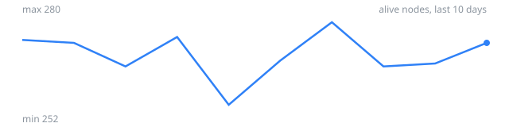

# crazygeeky · Free Node Subscriptions

[中文](README.md) | **English**

🌐 Website: [crazygeeky.com](https://crazygeeky.com) ｜ 📊 [Live node stats](https://crazygeeky.com/nodes/) ｜ 📱 [Clients & tutorials](https://crazygeeky.com/clients/)

  

The subscription files in this repository are published automatically by [crazygeeky.com](https://crazygeeky.com) after each check, roughly every 6 hours. Nodes come from public sources on the internet. They are liveness-checked and de-duplicated, and every node name carries a `crazygeeky |` prefix.

> ⚠️ **Risk notice**: Free nodes come from the internet and may be unsafe. **Do not use them to sign in to banking, payment, primary email or other sensitive accounts.** Follow the laws and regulations where you live. Checks run on an overseas server, so they only show whether a node is alive, its exit region and unlock status. **They do not reflect speed from mainland China.** Availability is not guaranteed.

## Subscription links

Copy a link below and paste it into your client's subscription settings.

| File | Works with | Subscription URL |
| --- | --- | --- |
| `base64.txt` | **Universal**: v2rayN, v2rayNG, Hiddify, Shadowrocket, etc. | `https://raw.githubusercontent.com/BruceWayen/crazygeeky/main/subs/base64.txt` |
| `all.yaml` | Clash / mihomo family: node list only, no routing rules | `https://raw.githubusercontent.com/BruceWayen/crazygeeky/main/subs/all.yaml` |
| `mihomo.yaml` | Clash Verge Rev, FlClash and other mihomo-core clients: full config with routing rules | `https://raw.githubusercontent.com/BruceWayen/crazygeeky/main/subs/mihomo.yaml` |

Not sure which one? **Use `mihomo.yaml` for Clash-family clients and `base64.txt` for everything else.**

## Live stats and on-demand subscriptions

<!-- STATS:START -->

**Last updated: 2026-11-26 18:15 (UTC+8)** | Alive nodes **265** | Alive rate **70.7%**

| Region | Alive | Subscription (Clash format) | Details |
| --- | --- | --- | --- |
| United States | 31 | [us.yaml](https://raw.githubusercontent.com/BruceWayen/crazygeeky/main/subs/us.yaml) | [/nodes/us/](https://crazygeeky.com/nodes/us.html) |
| Japan | 0 | fewer than 5, not provided | — |
| Singapore | 4 | fewer than 5, not provided | — |
| Hong Kong | 28 | [hk.yaml](https://raw.githubusercontent.com/BruceWayen/crazygeeky/main/subs/hk.yaml) | [/nodes/hk/](https://crazygeeky.com/nodes/hk.html) |
| Taiwan | 25 | [tw.yaml](https://raw.githubusercontent.com/BruceWayen/crazygeeky/main/subs/tw.yaml) | [/nodes/tw/](https://crazygeeky.com/nodes/tw.html) |
| Other | 177 | [other.yaml](https://raw.githubusercontent.com/BruceWayen/crazygeeky/main/subs/other.yaml) | [/nodes/other/](https://crazygeeky.com/nodes/other.html) |

| Unlock | Alive | Subscription (Clash format) | Details |
| --- | --- | --- | --- |
| Netflix | 0 | fewer than 5, not provided | — |
| ChatGPT | 0 | fewer than 5, not provided | — |
| Disney+ | 0 | fewer than 5, not provided | — |
| YouTube | 0 | fewer than 5, not provided | — |
| Gemini | 0 | fewer than 5, not provided | — |

History: [data/history.csv](data/history.csv) | Full stats: [https://crazygeeky.com/nodes/](https://crazygeeky.com/)

<!-- STATS:END -->

## More formats and docs

- All subscription formats and how the split files work: [docs/formats.md](docs/formats.md)
- FAQ: [docs/faq.en.md](docs/faq.en.md)
- Historical data: [data/history.csv](data/history.csv)
- A [Release](../../releases) with the weekly summary is published every Monday
- Having trouble? Open an [Issue](../../issues/new/choose) using a template, or join the [Discussions](../../discussions)

## How to use

These are the usual steps for popular clients. Button names may differ slightly between versions. For step-by-step guides, see the [Clients hub](https://crazygeeky.com/clients/).

**Clash Verge Rev (Windows / macOS / Linux)**
1. Open the app and go to the **Profiles** page.
2. Paste the `mihomo.yaml` URL into the input box at the top and click **Import**.
3. Select the imported profile, pick a node on the **Proxies** page, then turn on **System Proxy**.

**v2rayN (Windows)**
1. Menu **Subscription group** → **Subscription group settings** → add.
2. Enter an alias (e.g. crazygeeky) and the `base64.txt` URL, then save.
3. Menu **Subscription group** → **Update subscription (without proxy)**, then pick a node and enable it.

**v2rayNG (Android)**
1. Top-left menu → **Subscription group setting** → **＋** at the top right.
2. Enter an alias and the `base64.txt` URL, then save.
3. Back on the main screen, open the top-right menu → **Update subscription**, choose a node and tap the connect button.

**FlClash (Windows / macOS / Linux / Android)**
1. Go to the **Profiles** page, tap **＋** → **URL**.
2. Paste the `mihomo.yaml` URL, save and enable it.

**Hiddify (all platforms)**
1. Tap **＋ New profile** and choose to add from a link.
2. Paste the `base64.txt` URL, confirm, then connect.

**Shadowrocket (iOS)**
1. Tap **＋** at the top right of the home screen and set Type to **Subscribe**.
2. Enter the `base64.txt` URL, save, then pick a node and connect.

Download clients from their **official release pages**:
[Clash Verge Rev](https://github.com/clash-verge-rev/clash-verge-rev/releases) · [v2rayN](https://github.com/2dust/v2rayN/releases) · [v2rayNG](https://github.com/2dust/v2rayNG/releases) · [FlClash](https://github.com/chen08209/FlClash/releases) · [Hiddify](https://github.com/hiddify/hiddify-app/releases)

## FAQ

**Subscription update failed, or no nodes after importing?**
Open the subscription URL in your browser first. If it won't load, your current network can't reach GitHub. Switch networks, or see [What to do when a subscription fails to update](https://crazygeeky.com/troubleshoot/sub-update-failed/) (Chinese).

**A node shows as available but won't connect?**
Free nodes fluctuate. Try other nodes, or hit "update subscription" in your client to pull the latest round.

**How often is it updated?**
About every 6 hours. For the latest alive count and region breakdown, see [Live node stats](https://crazygeeky.com/nodes/).

**Want something more stable?**
Free nodes have limited stability. For long-term use, see the [airport buying guide](https://crazygeeky.com/airports/) (Chinese). That page may contain affiliate links and we may earn a commission.

## Disclaimer

- Nodes come from public sources. This repository only publishes structured results that have been checked and de-duplicated.
- For learning and research only. You use it at your own risk and must comply with local laws.
- We do not host any client installers. Please download from the official release pages.

---

🔗 [crazygeeky.com](https://crazygeeky.com) · [Node stats](https://crazygeeky.com/nodes/) · [Client tutorials](https://crazygeeky.com/clients/) · [Weekly reports](https://crazygeeky.com/weekly/)
