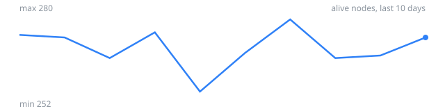

# crazygeeky · 免费节点订阅

**中文** | [English](README.en.md)

🌐 官网：[crazygeeky.com](https://crazygeeky.com) ｜ 📊 [实时节点检测](https://crazygeeky.com/nodes/) ｜ 📱 [客户端中心与教程](https://crazygeeky.com/clients/)

  

本仓库的订阅文件由 [crazygeeky.com](https://crazygeeky.com) 自动检测后发布，大约每 6 小时更新一次。节点来自网络公开来源，经过存活检测和去重，节点名带有 `crazygeeky |` 前缀。

> ⚠️ **风险提示**：免费节点来源于网络，可能不安全，**请勿用于登录银行、支付、主要邮箱等敏感账号**。请遵守你所在地的法律法规。检测在海外服务器进行，只反映节点是否存活、出口地区和解锁情况，**不代表国内网络下的速度**。本站不保证节点可用性。

## 订阅链接

复制下面的链接，粘贴到客户端的"订阅"里即可。

| 文件 | 适用客户端 | 订阅链接 |
| --- | --- | --- |
| `base64.txt` | **通用订阅**：v2rayN、v2rayNG、Hiddify、Shadowrocket 等 | `https://raw.githubusercontent.com/BruceWayen/crazygeeky/main/subs/base64.txt` |
| `all.yaml` | Clash / mihomo 系：只含节点列表，不含分流规则 | `https://raw.githubusercontent.com/BruceWayen/crazygeeky/main/subs/all.yaml` |
| `mihomo.yaml` | Clash Verge Rev、FlClash 等 mihomo 内核客户端：带分流规则的完整配置 | `https://raw.githubusercontent.com/BruceWayen/crazygeeky/main/subs/mihomo.yaml` |

不知道选哪个？**Clash 系客户端用 `mihomo.yaml`，其他客户端用 `base64.txt`。**

## 实时统计与按需订阅

<!-- STATS:START -->

**最近更新：2026-11-27 00:15（北京时间）**｜存活节点 **279**｜存活率 **69.9%**

| 地区 | 存活数 | 订阅文件（Clash 格式） | 详情页 |
| --- | --- | --- | --- |
| 美国 | 41 | [us.yaml](https://raw.githubusercontent.com/BruceWayen/crazygeeky/main/subs/us.yaml) | [/nodes/us/](https://crazygeeky.com/nodes/us.html) |
| 日本 | 0 | 数量少于 5，暂不提供 | — |
| 新加坡 | 5 | [sg.yaml](https://raw.githubusercontent.com/BruceWayen/crazygeeky/main/subs/sg.yaml) | [/nodes/sg/](https://crazygeeky.com/nodes/sg.html) |
| 香港 | 38 | [hk.yaml](https://raw.githubusercontent.com/BruceWayen/crazygeeky/main/subs/hk.yaml) | [/nodes/hk/](https://crazygeeky.com/nodes/hk.html) |
| 台湾 | 20 | [tw.yaml](https://raw.githubusercontent.com/BruceWayen/crazygeeky/main/subs/tw.yaml) | [/nodes/tw/](https://crazygeeky.com/nodes/tw.html) |
| 其他 | 175 | [other.yaml](https://raw.githubusercontent.com/BruceWayen/crazygeeky/main/subs/other.yaml) | [/nodes/other/](https://crazygeeky.com/nodes/other.html) |

| 解锁 | 存活数 | 订阅文件（Clash 格式） | 详情页 |
| --- | --- | --- | --- |
| Netflix | 0 | 数量少于 5，暂不提供 | — |
| ChatGPT | 0 | 数量少于 5，暂不提供 | — |
| Disney+ | 0 | 数量少于 5，暂不提供 | — |
| YouTube | 0 | 数量少于 5，暂不提供 | — |
| Gemini | 0 | 数量少于 5，暂不提供 | — |

历史数据：[data/history.csv](data/history.csv)｜完整统计：[https://crazygeeky.com/nodes/](https://crazygeeky.com/)

<!-- STATS:END -->

## 更多格式与文档

- 全部订阅格式、拆分订阅的说明：[docs/formats.md](docs/formats.md)
- 常见问题：[docs/faq.md](docs/faq.md)
- 历史数据可以直接用：[data/history.csv](data/history.csv)
- 每周一发布 [Release](../../releases)，附周报摘要
- 遇到问题请在 [Issues](../../issues/new/choose) 里选模板提交，或到 [Discussions](../../discussions) 交流

## 怎么使用

下面是常见客户端的大致步骤，不同版本的按钮名称可能略有差别。更详细的图文教程见 [客户端中心](https://crazygeeky.com/clients/)。

**Clash Verge Rev（Windows / macOS / Linux）**
1. 打开软件，进入「订阅」页面。
2. 在顶部输入框粘贴 `mihomo.yaml` 的订阅链接，点「导入」。
3. 选中刚导入的配置，在「代理」页选一个节点，再开启「系统代理」。

**v2rayN（Windows）**
1. 菜单「订阅分组」→「订阅分组设置」→ 添加。
2. 填入别名（例如 crazygeeky）和 `base64.txt` 的链接，保存。
3. 菜单「订阅分组」→「更新订阅（不通过代理）」，然后选一个节点启用。

**v2rayNG（Android）**
1. 左上角菜单 →「订阅分组设置」→ 右上角「＋」。
2. 填入别名和 `base64.txt` 的链接，保存。
3. 回到主界面，点右上角菜单 →「更新订阅」，选择节点后点底部连接按钮。

**FlClash（Windows / macOS / Linux / Android）**
1. 进入「配置」页，点「＋」→「URL」。
2. 粘贴 `mihomo.yaml` 的链接，保存并启用。

**Hiddify（全平台）**
1. 点「＋ 新建配置」，选择从链接添加。
2. 粘贴 `base64.txt` 的链接并确认，然后点连接。

**Shadowrocket（iOS）**
1. 首页右上角「＋」，类型选「Subscribe」。
2. URL 填 `base64.txt` 的链接，保存后选一个节点连接。

客户端下载请前往**官方发布页**：
[Clash Verge Rev](https://github.com/clash-verge-rev/clash-verge-rev/releases) · [v2rayN](https://github.com/2dust/v2rayN/releases) · [v2rayNG](https://github.com/2dust/v2rayNG/releases) · [FlClash](https://github.com/chen08209/FlClash/releases) · [Hiddify](https://github.com/hiddify/hiddify-app/releases)

## 常见问题

**订阅更新失败 / 导入后没有节点？**
先在浏览器里打开订阅链接，看能不能访问。如果打不开，说明你当前网络访问不了 GitHub，请先换一个网络环境，或查看 [订阅更新失败怎么办](https://crazygeeky.com/troubleshoot/sub-update-failed/)。

**节点显示可用却连不上？**
免费节点可用性会波动。可以多换几个节点，或点客户端的"更新订阅"拿最新一轮。

**更新频率？**
大约每 6 小时一次。想看最近一轮的存活数量和地区分布，请看 [实时节点检测](https://crazygeeky.com/nodes/)。

**想要更稳定的服务？**
免费节点的稳定性有限，需要长期稳定使用可以参考 [机场选购指南](https://crazygeeky.com/airports/)。该页面可能含推广链接，我们可能因推荐获得佣金。

## 声明

- 节点来源于网络公开来源，本仓库只发布经过检测、去重后的结构化结果。
- 本仓库仅供学习和研究，使用者须自行承担风险并遵守当地法律法规。
- 本站不托管任何客户端安装包，请从官方发布页下载。

---

🔗 [crazygeeky.com](https://crazygeeky.com) · [节点检测](https://crazygeeky.com/nodes/) · [客户端教程](https://crazygeeky.com/clients/) · [周报](https://crazygeeky.com/weekly/)
